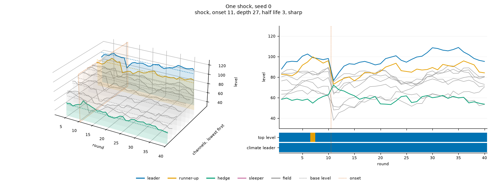
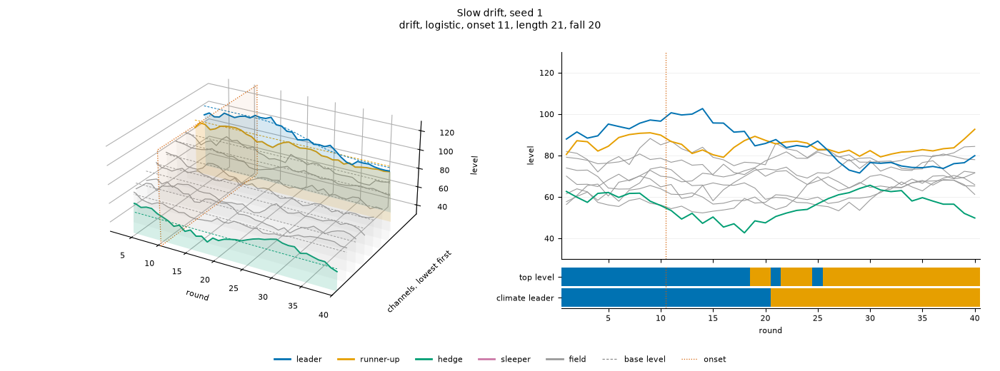
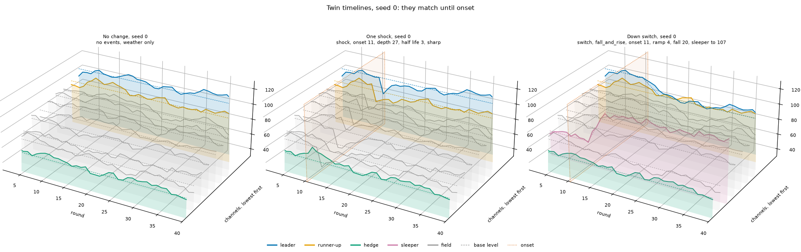

# Shapes

**What each shape is for, how the engine draws it today, and whether it does its job.**

A [shape](../docs/glossary.md#how-the-world-changes) is the kind of move an event makes: a shock, a switch or a drift. Under every event sits the weather. The engine pilot found that more noise does not make the game harder. This folder tests whether the shapes are the reason.

Nothing here changes the engine. It reads `paranoid.engine` and draws pictures and numbers, so a redesign can start from them.

- [`criteria.md`](criteria.md) holds every measure on 1000 public seeds. The code writes it.
- [`images/`](images) holds one picture per scenario for seeds 0 to 4, and the [twin timelines](../docs/glossary.md#seeds-and-secrecy) of three scenarios side by side.
- [`src/`](src) holds the code. `make.py` runs it all, `draw.py` draws one timeline, and `criteria.py` holds the measures.

## What each shape is for

- **Weather** makes the world feel real. It should move the leader, and sometimes take it off the top spot. A shock should then read as a storm, not a bolt from nowhere.
- **A shock** should knock the leader down and shake up the whole system, with some channels dropping hard and others popping. Its job is to make the agent question its plan and explore.
- **A switch** should look like a shock at first, then leave a new state. Its job is to test whether the agent updates its plan well.
- **A drift** is a switch stretched out, with no sudden move.

## How the engine draws them today

The full rules are in [mechanics](../docs/design/mechanics.md#events) and the [timeline spec](../docs/specs/engine/timeline.md#events). In short:

**Weather**, see [weather and the shared factor](../docs/specs/engine/timeline.md#weather-and-the-shared-factor)
- Each channel has its own weather, with an SD of 4 points (one sigma) and a persistence of 0.8.
- A shared factor with an SD of 3 moves every channel at once, each by its loading of 0.3 to 1.0. The hedge loads −0.6 to −0.3, so it moves the other way.
- The leader starts 8 to 16 points above the runner-up. The field starts at least 4 points below the runner-up.

**A shock**, see [shock](../docs/specs/engine/timeline.md#shock)
- An impulse into the shared factor, 16 to 32 points deep, that decays with a half life of 2 to 4 rounds.
- It is sharp, a fall all at once, or a slide over a few rounds. Either way it passes.
- Every channel moves by its loading, so the whole field falls together and the hedge rises.
- The depth is capped so the hedge stays at least 4 points below the leader at the trough.

**A switch**, see [switch](../docs/specs/engine/timeline.md#switch)
- It moves a base level, over a ramp of 1 to 5 rounds, and leaves the shared factor alone.
- A `fall` takes the leader to 4 to 12 points below the runner-up. A `rise` lifts a sleeper 12 to 24 points above every other channel. A `fall_and_rise` does both.
- On some Up switch seeds the sleeper stops short of the leader, `rise_short`, so the right call is to stay.

**A drift**, see [drift](../docs/specs/engine/timeline.md#drift)
- The leader falls to 8 to 16 points below the runner-up, linearly or on an S-curve, over 15 to 25 rounds.

## The test

One measure set per purpose, read on twin timelines. One seed's event timeline minus its No change timeline is the event alone, with the weather taken out. The full table is in [criteria](criteria.md).

| Purpose | On 1000 public seeds | Verdict |
|---|---|---|
| Weather moves the leader | The leader is off the top spot in 3% of rounds, and off for three rounds running on 11% of seeds. Its SD is 3.9 points against a 12 point gap | Fails |
| A shock is a storm | Its largest one round fall is 1.25 times the worst one weather gives the leader, so a round can pass for bad weather. Its whole fall is 2.4 times that, and smaller on only 2% of shocks | Partly |
| A shock knocks the leader down | 15 points at the trough, 8 to 23 | Meets |
| A shock shakes up the system | Nine channels fall and one rises, the hedge. Hedge aside, 5 of 36 pairs swap places. The leader is overtaken on 5% of shocks before weather | Fails. It is a parallel fall |
| A shock makes holding a real question | The leader is off the top spot for 0.5 of the 8 rounds after onset, against 0.2 with no shock. Another channel beats it over those rounds on 2% of seeds | Fails |
| A switch looks like a shock | At onset a switch moves 1.4 channels by more than a sigma and a shock 7.1. Three rounds of the field tell them apart every time, AUC 1.00. From the leader's seat alone, AUC 0.80 | Fails |
| A switch leaves a new state | The climate leader changes and stays changed on every `fall`, `fall_and_rise` and `rise` seed, and never on `rise_short`, by design | Meets |
| A drift has no sudden move | Its largest one round fall in base level is 1.7 points, against 6.1 for the worst weather round | Meets |

So weather and the shock are where the game is easy. Weather rarely takes the leader off the top spot. A shock takes the whole field down together, so the leader stays on top and holding is safe. And a switch moves one or two channels, while a shock moves nearly all ten, so any look at the field tells them apart.

A few notes on reading the numbers:
- **The field AUC** fits a straight line on half the seeds to the leader's move and the median and largest move of the other nine, over the three rounds from onset. It is read on the other half. The leader's seat uses the leader's move alone. Both read levels, with no read noise, so a real agent sees less.
- **The shake up** is read before weather: base level plus loading times the shock's impulse, at the trough. With weather on, the leader is off the top spot for 0.5 rounds, see the holding row.
- **Off for three rounds running** sits beside the [pilot's](../docs/pilot/results.md#streaks) 0.10 of No change seeds with the leader below the runner-up for three rounds. Here that same measure is 0.10 too.

## How to read a picture

Each picture is one timeline: one scenario on one seed. The title gives what the seed drew, such as `shock, onset 11, depth 27, half life 3, sharp`.

- **Left, the 3D view.** Rounds run along the front. Each channel has a slot going back, ordered by its round 1 base level, lowest in front and the leader at the back, so a high ridge rarely hides a low one. A rising sleeper can hide the ridges behind it.
- **The solid line** is a channel's level. **The dashed line** is its base level, the climate. The pale curtain under each line makes it read as a shape.
- **Colour is role:** blue for the leader, orange for the runner-up, green for the hedge, pink for the sleeper and grey for the rest of the field.
- **The vermilion frame** marks each event's onset, between the last round before it and the first round it moves.
- **Right, the same timeline flat.** All ten levels on one axis.
- **The strip beneath** shows which channel is on top each round, by level and by base level. The top row is the direct picture of "does the leader ever lose the top spot".
- **Every picture shares one level axis**, so seeds and scenarios compare by eye.

### Weather

No change, seed 0. The leader stays on top in all but one round.

### A shock

One shock, seed 0. Every channel dips at round 11 and the hedge pops. The order barely moves, and the leader stays on top in every round after onset.

### A switch

Down switch, seed 0. The leader slides below the runner-up over four rounds, and a sleeper rises past both. Only those two channels move.

### A drift

Slow drift, seed 1. The leader sinks over 21 rounds and the runner-up takes over at round 21.

### Twin timelines

No change, One shock and Down switch on seed 0. They match until onset, so the gap between panels is exactly what each event adds.

### Every picture

| Scenario | Seeds |
|---|---|
| No change | [0](images/no_change/seed-0.png) [1](images/no_change/seed-1.png) [2](images/no_change/seed-2.png) [3](images/no_change/seed-3.png) [4](images/no_change/seed-4.png) |
| One shock | [0](images/one_shock/seed-0.png) [1](images/one_shock/seed-1.png) [2](images/one_shock/seed-2.png) [3](images/one_shock/seed-3.png) [4](images/one_shock/seed-4.png) |
| Down switch | [0](images/down_switch/seed-0.png) [1](images/down_switch/seed-1.png) [2](images/down_switch/seed-2.png) [3](images/down_switch/seed-3.png) [4](images/down_switch/seed-4.png) |
| Up switch | [0](images/up_switch/seed-0.png) [1](images/up_switch/seed-1.png) [2](images/up_switch/seed-2.png) [3](images/up_switch/seed-3.png) [4](images/up_switch/seed-4.png) |
| Shock then switch | [0](images/shock_then_switch/seed-0.png) [1](images/shock_then_switch/seed-1.png) [2](images/shock_then_switch/seed-2.png) [3](images/shock_then_switch/seed-3.png) [4](images/shock_then_switch/seed-4.png) |
| Slow drift | [0](images/slow_drift/seed-0.png) [1](images/slow_drift/seed-1.png) [2](images/slow_drift/seed-2.png) [3](images/slow_drift/seed-3.png) [4](images/slow_drift/seed-4.png) |
| Switch then shock | [0](images/switch_then_shock/seed-0.png) [1](images/switch_then_shock/seed-1.png) [2](images/switch_then_shock/seed-2.png) [3](images/switch_then_shock/seed-3.png) [4](images/switch_then_shock/seed-4.png) |
| Up switch then down switch | [0](images/up_switch_then_down_switch/seed-0.png) [1](images/up_switch_then_down_switch/seed-1.png) [2](images/up_switch_then_down_switch/seed-2.png) [3](images/up_switch_then_down_switch/seed-3.png) [4](images/up_switch_then_down_switch/seed-4.png) |
| Twins | [0](images/twins/seed-0.png) [1](images/twins/seed-1.png) [2](images/twins/seed-2.png) [3](images/twins/seed-3.png) [4](images/twins/seed-4.png) |

## Redraw everything

    uv run python shapes/src/make.py

- It draws 45 pictures and writes `criteria.md` in about seven seconds. Two runs give the same bytes.
- `--seeds 0 1 2 3 4` picks the seeds to draw. `--criteria-seeds 1000` sets how many public seeds the criteria read, from the top of `configs/seeds/public.txt`.
- The code imports only the engine's public exports, numpy and matplotlib. It sits outside the package, so it is not a layer and the import lint does not read it.
- When the engine changes, rerun it and check the verdicts above against the new `criteria.md`.
