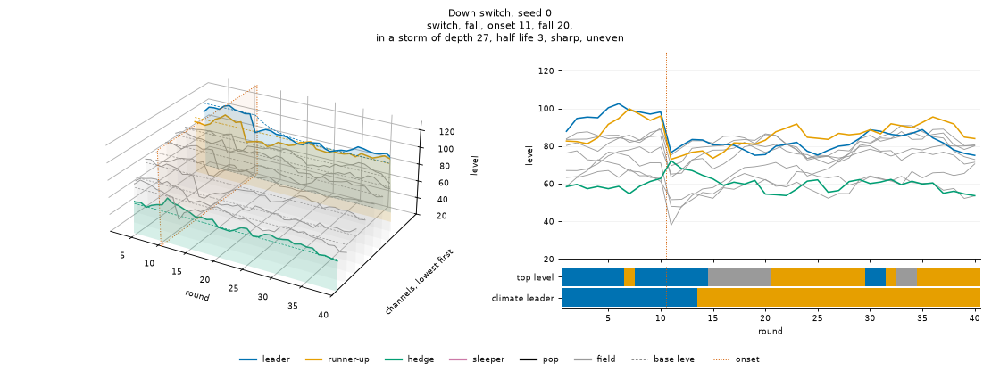
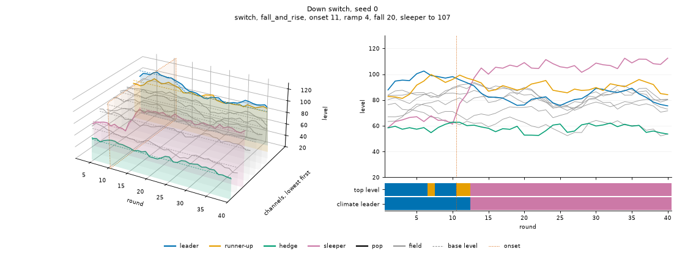
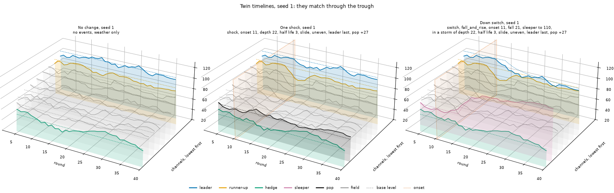
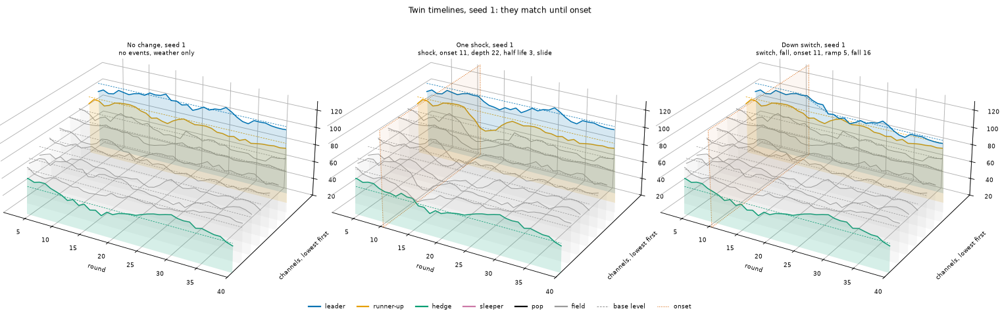

# Shapes

**What each shape is for, how the engine draws it today and with the shape knobs on, and whether each does its job.**

A [shape](../docs/glossary.md#how-the-world-changes) is the kind of move an event makes: a shock, a switch or a drift. Under every event sits the weather. The engine pilot found the game too easy, and the first pass of this folder found why: a shock moves every channel and a switch moves one, so one look at the field tells them apart. The engine now has **shape knobs** that change that, all off by default. This folder draws and scores both worlds side by side.

- [`criteria.md`](criteria.md) holds every measure on 1000 public seeds, in a Today and a New column. The code writes it.
- [`readers.md`](readers.md) holds what two good readers score in each world, from the optional `--readers` step.
- [`images/`](images) holds the new world. [`images/today/`](images/today) keeps today's pictures for the four scenarios the knobs change.
- [`src/`](src) holds the code. `make.py` runs it all, `worlds.py` holds the knob values, `measures.py` and `criteria.py` the test, `draw.py` the pictures and `readers.py` the readers.

## What each shape is for

| Shape | Purpose |
|---|---|
| Weather | Gives the leader bad runs that, from the agent's seat, sometimes look like an event starting. It is never worth chasing |
| Shock | A storm that passes, too big to be weather. Every channel dips and comes back at its own speed, sometimes the leader last, and one channel can pop to just under the leader. Holding is right, leaving looks right, and leaving costs |
| Switch | A lasting change that arrives in a storm. Its first rounds match a shock's on the same seed. Then the field comes back and the leader does not, and staying costs more each round. Sometimes the channel that popped stays up and is the new best |
| Drift | The other lasting change, which slides in. No storm, and no short stretch stands out from weather until the fall is worth acting on |
| Rise | A sleeper rises while the leader holds. Nothing in the agent's record moves. It rewards small, steady looking, and is sometimes not worth the move |
| Looking | An explore bet shifts the odds, but one round never settles it. A small bet is rough, so a clear view costs points. What tells a shock from a switch is who comes back, not who fell |

## Today and new

The rules are in the [storm spec](../docs/specs/engine/timeline.md#storm). The New world is the eight scenarios with the knobs below, set in [`worlds.py`](src/worlds.py). No rule of play changes.

| Shape | Today | New |
|---|---|---|
| Weather | Own weather with an SD of 4 points and a persistence of 0.8. A shared factor with an SD of 3, which every channel loads on by 0.3 to 1.0 and the hedge by −0.6 to −0.3 | The same |
| Shock | An impulse into the shared factor, 16 to 32 points deep, sharp or a slide, with a half-life of 2 to 4 rounds. Every channel falls and comes back together. The leader is overtaken at the trough on 5% of shocks | The same impulse. Each channel's half-life is multiplied by 0.5 to 1.5, `recovery`. On half of shocks the leader gets the slowest, `leader_last_share`. On half, one field channel pops to 4 points under the leader at the trough, `pop_share`. Before weather the leader stays 4 points ahead, `leader_stays_ahead` |
| Switch | The leader's base falls to 4 to 12 points below the runner-up's over a ramp of 1 to 5 rounds. Half the time a sleeper rises past every channel | Every fall arrives in the scenario's shock, `storm`, drawn first so the Down switch's storm is the One shock's shock. The leader's base falls as the storm lifts off it. A sleeper is the channel that popped when there is one, and stays up |
| Drift | The leader's base falls to 8 to 16 points below the runner-up's over 15 to 25 rounds | The same |
| Rise | A sleeper rises 12 to 24 points past every channel. On a quarter of Up switch seeds it stops short | The same. A rise and an undo stay quiet |
| Looking | A reading's SD is `k / sqrt(bet)` with a k of 8 | A k of 12, so a one point look has an SD of 12 |

## The test

One measure set per purpose, from above and from the agent's seat, on 1000 public seeds. Every band is a proposal, for you to change. The full table is in [criteria](criteria.md).

| Purpose | Measure | Band | Today | New | New |
|---|---|---|---|---|---|
| Weather | Seeds where calm weather gives the leader a three round fall as deep as a storm's first three | 0.2 to 0.5 | 0.45 | 0.42 | Meets |
| Weather | Points a round chasing last round's best one point reading earns over holding | Below 0 | −1.45 | −4.52 | Meets |
| Shock | The leader's fall at the trough over the worst one round fall weather gives it | Median 1.5 or more | 2.39 | 2.39 | Meets |
| Shock | Storm rounds the leader is at least the margin ahead, before weather | 1.00 | 0.96 | 1.00 | Meets |
| Shock | Storm rounds a one point reading of another channel beats the leader's | 0.3 to 0.6 | 0.22 | 0.46 | Meets |
| Shock | Points a round leaving at the trough for the best other channel costs | Median 2 or more | 14.7 | 15.5 | Meets |
| Switch | Rounds from onset the twins match exactly | 1 or more on every seed | 0 | 2.5 (1 to 5) | Meets |
| Switch | Rounds from onset until the climate leader changes | 3 to 9 | 1.1 (0 to 2) | 5.0 (3 to 8) | Meets |
| Switch | Points a holder gives up 2, 4 and 8 rounds after the trough | Rises from near 0 | 9.3, 17.8, 17.8 | 0.0, 4.1, 10.6 | Meets |
| Switch | Down switch seeds where the channel that popped ends as the best | 0.1 to 0.4 | 0.00 | 0.26 | Meets |
| Drift | Its largest three round fall in base level, against weather's worst three round fall | Below weather's | 5.1 against 9.1 | The same | Meets |
| Drift | Rounds from a two sigma fall to the climate leader changing | 0 to 5 | 2.4 | 2.4 | Meets |
| Rise | Up switch seeds where the leader's levels differ from No change | 0.00 | 0.00 | 0.00 | Meets |
| Rise | Seeds that stop short, and seeds where moving to the sleeper earns less than holding | 0.1 to 0.4 each | 0.23, 0.21 | 0.23, 0.21 | Meets |
| Looking | AUC from one point looks at a k of 12, after one round | 0.7 or less | 0.82 | 0.50 | Meets |
| Looking | The same after six rounds | 0.9 or more | 0.99 | 0.92 | Meets |
| Looking | What four point looks add to the AUC over all on the leader, after three rounds | 0.05 or more | 0.20 | 0.02 | Fails |

So the new world does what the purposes ask from above, but two findings need a talk, this one and the [readers'](#two-readers):

- **Looking barely pays on a shock or a switch.** In the new world a storm switch's field is its twin shock's field, by design, so the field comes back in both and says little. What tells them apart is whether the leader comes back, which an agent all in on the leader already sees. An explore bet still finds the pop, the sleeper and a rise, which these AUCs do not score.
- **One value moved while tuning.** `recovery` was 0.5 to 2.0 in the plan. There the six round AUC was 0.89 at a k of 12, under its band, as a leader that comes back four times slower than usual looks like a switch for a long time. At 0.5 to 1.5 it is 0.92 and every other row stays in its band.

A few notes on reading the numbers:
- **An AUC** fits a straight line on half the seeds and reads it on the other half. The leader's seat uses the leader's move each round, less its mean over the three rounds before onset. The field seats add the median and largest move of the other nine. A curved read might do better.
- **A seat** is a fixed split: all 100 on the leader, 1 point on each other channel and 91 on the leader, or 4 on each and 64 on the leader. Its readings add read noise as the game does, from the timeline's own draws.
- **Before weather** is base level plus the event's effect, so it is what the engine places, with no weather on top.
- **Points a holder gives up** read base level, so they are what staying costs on average, not on one seed's weather.

## Two readers

`--readers` plays the hedge rule and the Bayesian baseline at each of its five hazards on No change, One shock and Down switch, on 100 seeds of both worlds. It answers the two questions the pilot asked: what a shock costs a good reader, and whether the best hazard for One shock differs from the best for Down switch. Both readers were built for today's shapes, so read it as a first look. The table is in [readers](readers.md).

| Reader | Today: No change, One shock, Down switch | New: the same |
|---|---|---|
| Hedge rule | 0.96, 0.95, 0.91 | 0.96, 0.91, 0.79 |
| Bayesian at 0.005 | 0.98, 0.97, 0.94 | 0.98, 0.96, 0.93 |
| Bayesian at 0.01 | 0.97, 0.96, 0.94 | 0.97, 0.95, 0.93 |

- **A shock still costs a good reader little.** The Bayesian baseline loses 0.01 to 0.03 to a shock in either world. The hedge rule loses 0.05 in the new world against 0.01 today, as its tell no longer works.
- **The calmest prior still wins both.** The best hazard is 0.005 on One shock and on Down switch, in both worlds.
- **So the new shapes beat a rule, not a reader.** A storm switch delays when a fall shows by about four rounds, which costs a patient Bayesian little over 40 rounds. The next pass should ask what would make a shock tempt it to move.

## How to read a picture

Each picture is one timeline: one scenario on one seed. The title gives what the seed drew, such as `shock, onset 11, depth 22, half life 3, slide, uneven, leader last, pop +27`. `uneven` means the channels come back at their own speeds. A storm switch names its storm on a second line.

- **Left, the 3D view.** Rounds run along the front. Each channel has a slot going back, ordered by its round 1 base level, lowest in front and the leader at the back.
- **The solid line** is a channel's level. **The dashed line** is its base level, the climate.
- **Colour is role:** blue for the leader, orange for the runner-up, green for the hedge, pink for the sleeper, black for the pop and grey for the rest of the field.
- **The vermilion frame** marks each event's onset.
- **Right, the same timeline flat**, and beneath it which channel is on top each round, by level and by base level.
- **Every picture shares one level axis**, so seeds, scenarios and worlds compare by eye.

### A shock, new

One shock, seed 1. Every channel dips at round 11 and the field comes back at different speeds. The leader comes back last. The pop, in black, climbs to 4 points under the leader before weather. Its own weather that round is two sigmas down, so it shows lower.

### A switch, new and today

Down switch, seed 0. In the new world the storm is the One shock's, and the leader's base slides away as it lifts, so the climate leader changes three rounds after onset. Today, the leader alone falls at onset.

### Twin timelines

No change, One shock and Down switch on seed 1. In the new world they match through the trough, then the field comes back in both, and only the leader does not. Today they part at onset.

### Every picture

| Scenario | New | Today |
|---|---|---|
| No change | [0](images/no_change/seed-0.png) [1](images/no_change/seed-1.png) [2](images/no_change/seed-2.png) [3](images/no_change/seed-3.png) [4](images/no_change/seed-4.png) | The same |
| One shock | [0](images/one_shock/seed-0.png) [1](images/one_shock/seed-1.png) [2](images/one_shock/seed-2.png) [3](images/one_shock/seed-3.png) [4](images/one_shock/seed-4.png) | [0](images/today/one_shock/seed-0.png) [1](images/today/one_shock/seed-1.png) [2](images/today/one_shock/seed-2.png) [3](images/today/one_shock/seed-3.png) [4](images/today/one_shock/seed-4.png) |
| Down switch | [0](images/down_switch/seed-0.png) [1](images/down_switch/seed-1.png) [2](images/down_switch/seed-2.png) [3](images/down_switch/seed-3.png) [4](images/down_switch/seed-4.png) | [0](images/today/down_switch/seed-0.png) [1](images/today/down_switch/seed-1.png) [2](images/today/down_switch/seed-2.png) [3](images/today/down_switch/seed-3.png) [4](images/today/down_switch/seed-4.png) |
| Up switch | [0](images/up_switch/seed-0.png) [1](images/up_switch/seed-1.png) [2](images/up_switch/seed-2.png) [3](images/up_switch/seed-3.png) [4](images/up_switch/seed-4.png) | The same |
| Shock then switch | [0](images/shock_then_switch/seed-0.png) [1](images/shock_then_switch/seed-1.png) [2](images/shock_then_switch/seed-2.png) [3](images/shock_then_switch/seed-3.png) [4](images/shock_then_switch/seed-4.png) | [0](images/today/shock_then_switch/seed-0.png) [1](images/today/shock_then_switch/seed-1.png) [2](images/today/shock_then_switch/seed-2.png) [3](images/today/shock_then_switch/seed-3.png) [4](images/today/shock_then_switch/seed-4.png) |
| Slow drift | [0](images/slow_drift/seed-0.png) [1](images/slow_drift/seed-1.png) [2](images/slow_drift/seed-2.png) [3](images/slow_drift/seed-3.png) [4](images/slow_drift/seed-4.png) | The same |
| Switch then shock | [0](images/switch_then_shock/seed-0.png) [1](images/switch_then_shock/seed-1.png) [2](images/switch_then_shock/seed-2.png) [3](images/switch_then_shock/seed-3.png) [4](images/switch_then_shock/seed-4.png) | [0](images/today/switch_then_shock/seed-0.png) [1](images/today/switch_then_shock/seed-1.png) [2](images/today/switch_then_shock/seed-2.png) [3](images/today/switch_then_shock/seed-3.png) [4](images/today/switch_then_shock/seed-4.png) |
| Up switch then down switch | [0](images/up_switch_then_down_switch/seed-0.png) [1](images/up_switch_then_down_switch/seed-1.png) [2](images/up_switch_then_down_switch/seed-2.png) [3](images/up_switch_then_down_switch/seed-3.png) [4](images/up_switch_then_down_switch/seed-4.png) | The same |
| Twins | [0](images/twins/seed-0.png) [1](images/twins/seed-1.png) [2](images/twins/seed-2.png) [3](images/twins/seed-3.png) [4](images/twins/seed-4.png) | [0](images/today/twins/seed-0.png) [1](images/today/twins/seed-1.png) [2](images/today/twins/seed-2.png) [3](images/today/twins/seed-3.png) [4](images/today/twins/seed-4.png) |

## Redraw everything

    uv run python shapes/src/make.py
    uv run python shapes/src/make.py --readers

- It draws 70 pictures and writes `criteria.md` in about 15 seconds. Two runs give the same bytes. `--readers` also writes `readers.md`, in a few minutes.
- `--seeds 0 1 2 3 4` picks the seeds to draw. `--criteria-seeds 1000` sets how many public seeds the criteria read, from the top of `configs/seeds/public.txt`.
- The code imports the engine's public exports, numpy and matplotlib, and `--readers` the baselines too. It sits outside the package, so it is not a layer and the import lint does not read it.
- To try other knob values, change `KNOBS` or `READ_NOISE_K` in [`worlds.py`](src/worlds.py) and rerun. The engine's defaults stay off.
